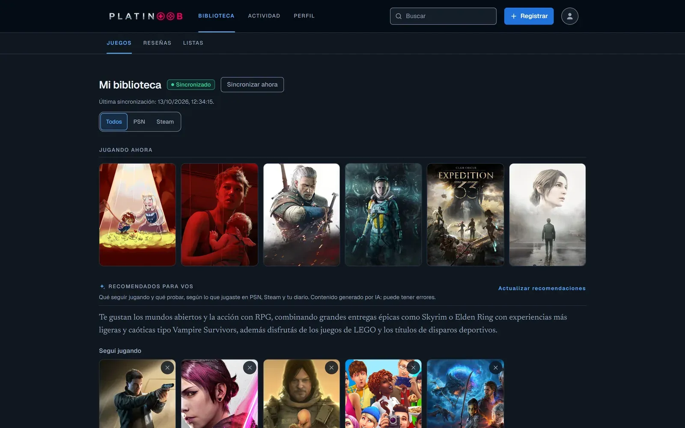
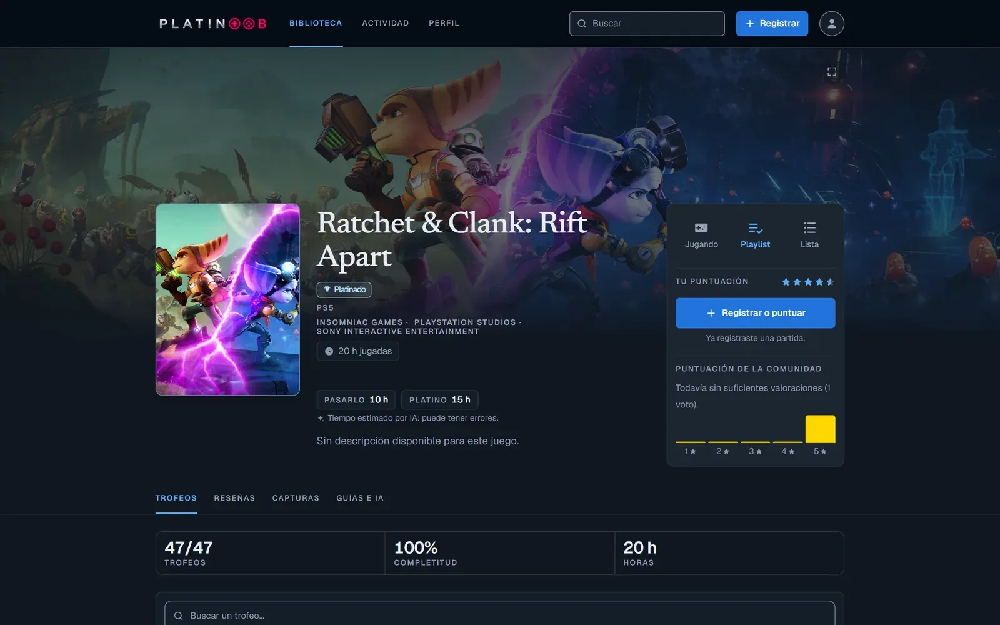
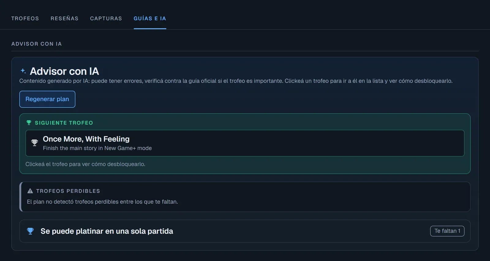
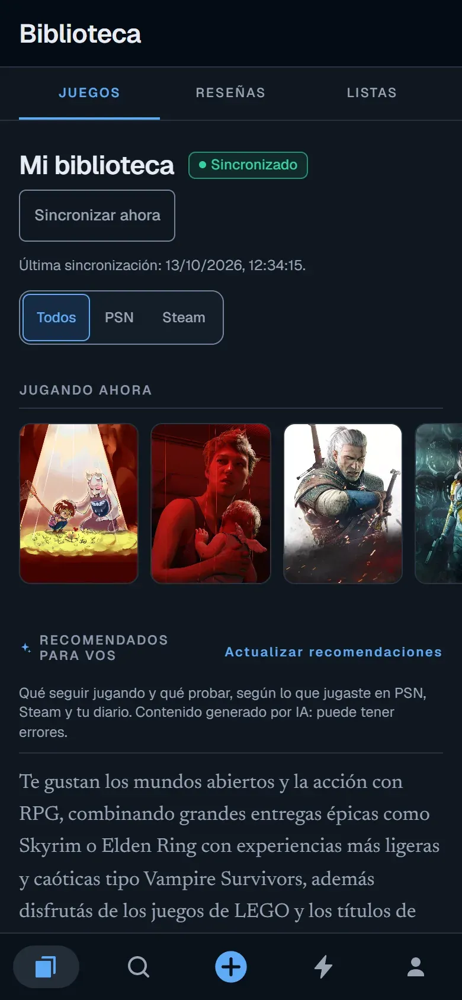
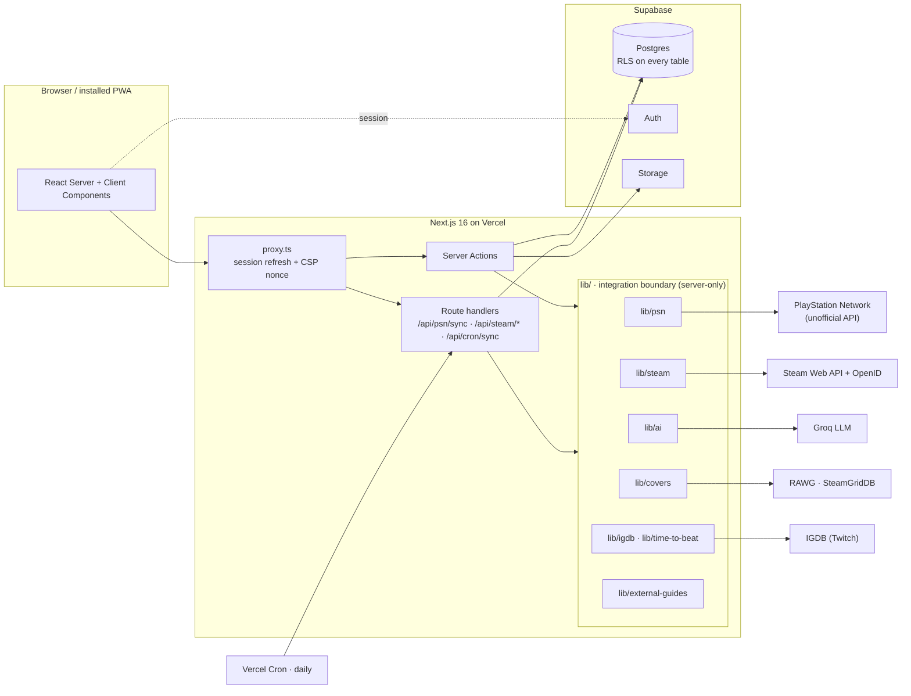

<div align="center">


# Platinoob

**A Letterboxd for games, with an AI that plans your road to every platinum.**

Link your PlayStation Network or Steam account, Platinoob syncs every trophy and achievement,
and an AI advisor tells you what to unlock next, what you can miss forever and whether one
playthrough is enough.

[](https://github.com/YagoLopolito/proyecto-platino/actions/workflows/e2e.yml)


[**Live app**](https://platinoob.vercel.app) ·
[Test strategy](TESTING_PRD.md) ·
[Accessibility audit](ACCESSIBILITY.md) ·
[Product spec](PRODUCT_SPEC.md)



</div>

---

## Contents

- [Why it exists](#why-it-exists)
- [Features](#features)
- [Screenshots](#screenshots)
- [Architecture](#architecture)
- [Quality engineering](#quality-engineering)
- [Security](#security)
- [Getting started](#getting-started)
- [Project structure](#project-structure)
- [Documentation](#documentation)
- [Known limitations](#known-limitations)

## Why it exists

Trophy hunters juggle three things: a tracker to see their progress, a guide site to know
what is missable, and a spreadsheet to plan playthroughs. Platinoob puts them in one place
and adds the social layer of Letterboxd: a diary of what you played, reviews, lists and a feed
of what your friends are playing.

Sony has no public trophy API, so the app is built defensively: every external integration is
isolated behind its own module, fails soft, and is mocked end to end in CI.

## Features

**Tracking**
- **PSN and Steam side by side.** PSN connects with the user's NPSSO token through the
  community-documented API; Steam through the official Web API, with account ownership
  verified by Steam OpenID.
- **Automatic sync.** Manual sync with a cooldown, plus a daily background job (Vercel Cron)
  for every connected account. Expired PSN tokens are detected and the UI asks to reconnect.
- **Game page.** Trophy list with rarity and completion, hours played, and time to beat for
  the main story and 100% (IGDB, with an AI estimate as a clearly labelled fallback).

**AI advisor** (Groq, server-side only)
- **Platinum plan:** suggested trophy order, missable trophies and their point of no return,
  single run vs. New Game+ or separate playthroughs. Validated against a schema, retried once
  on bad output, cached and versioned.
- **Next trophy** suggestion and per-trophy hints, rate limited per user.
- **Recommendations** from the whole library: what to keep playing and what to try next.
- **External guides** collected automatically from Steam Community, PowerPyx, PSNProfiles and
  TrueTrophies.

**Social**
- **Diary and reviews:** log what you played, with scores and completion dates, Letterboxd
  style.
- **Lists** (your own and auto-generated ones), **playlist**, **likes**, **Now playing** and
  a **Top 5** on the profile.
- **Friends and activity:** follow people, see what they play, and get likes and comments in
  an inbox with unread counters.
- **Online gallery:** photo and video posts per game, with bulk screenshot import.
- **Studio pages and search** across the whole catalogue.

**Everywhere**
- **Installable PWA** on Android and iOS that offers to update after every deploy.
- **Mobile-first UI** with a 5-tab bottom navigation, built on a token-based design system.
- **Spanish UI** (es-AR), dark theme only.

## Screenshots

<table>
  <tr>
    <td width="50%"></td>
    <td width="50%"></td>
  </tr>
  <tr>
    <td align="center"><sub><b>Game page</b>: trophies, hours played and time to beat</sub></td>
    <td align="center"><sub><b>AI advisor</b>: next trophy, missables, single run vs. New Game+</sub></td>
  </tr>
</table>

<p align="center">
  <br>
  <sub><b>Mobile</b>: the same library as an installed PWA</sub>
</p>

## Architecture



**Key decisions**

| Decision | Why |
| --- | --- |
| Every external call lives in one module under `lib/` (`psn`, `steam`, `ai`, `covers`, `igdb`, `external-guides`) | The PSN API is unofficial and can change without notice: one place to adapt and one place to mock. The modules import `server-only`, so the build fails if one ever reaches a client bundle. |
| Mutations are Server Actions, not REST endpoints | Session cookies stay on the server and forms work with `useActionState`. Route handlers are kept for long-running syncs (`maxDuration`) and the cron. |
| The shared catalogue (`games`, `trophies`) is written only by the sync, with the service role | Everyone can read it, nobody can edit or delete it from a session, so one account cannot corrupt data for all users. |
| AI output is structured JSON validated with Zod | A malformed response is retried once, then stored as an error and shown as "could not generate", never as a silent 500. |
| Bounded concurrency and bulk upserts in the sync | A first sync touches dozens of games; writing trophy by trophy did not fit in a serverless time limit. |

**Stack:** Next.js 16 (App Router) · React 19 · TypeScript (strict) · Tailwind CSS 4 ·
Supabase (Postgres, Auth, Storage) · Zod · Groq · `psn-api` · Playwright · GitHub Actions ·
Vercel.

## Quality engineering

Testing is a rule of the repository, not an afterthought: **every behaviour change ships with
its automated tests in the same pull request**, and CI runs them on every PR.

| | |
| --- | --- |
| **311 end-to-end tests** | 34 spec files, written from a [test case matrix](TESTING_PRD.md) where each test title starts with its case ID (`AUTH-03`, `SEC-10`, `PWA-02`…) |
| **5 Playwright projects** | `anon` (30) · `authed` (238) · `authed-b` (12) · `mobile` on a Pixel 7 viewport (24) · `smoke` against the live deploy (7) |
| **Accessibility & mobile** | One `h1` per screen, no horizontal scroll, bottom navigation, PWA manifest and service worker checks, plus a written [WCAG 2.1 AA contrast audit](ACCESSIBILITY.md) of every design token |
| **Security** | Cross-user isolation, RLS, CSP and hardening specs (`12-security-isolation`, `37-posts-security`, `38-security-hardening`) |
| **Static checks** | `tsc --noEmit` and ESLint in CI, including a custom rule (with its own `node:test` suite) that bans raw Tailwind colours outside the design tokens |

**Deterministic without hitting real APIs.** Almost every mutation is a Server Action, so
mocking in the browser with `page.route()` is not an option. Instead a single server-side
switch, `E2E_MOCKS=1`, makes each integration module return fixtures: valid and expired PSN
tokens, public and private Steam profiles, AI schema failures and more. The switch is read
**only inside `lib/`**, never in pages or actions, so the production code paths are the ones
under test. Checks against the real services are tagged `@live` and run by hand.

**Test data lifecycle.** A global setup creates disposable users through the Supabase admin
API and saves their logged-in sessions once; a teardown removes every row the run created
(prefixed `[E2E]`), including leftovers from an interrupted run. No test depends on another
test's data.

**CI pipeline** ([`.github/workflows/e2e.yml`](.github/workflows/e2e.yml))

```
pull_request · push to master
├── Lint + types        npm run lint · next typegen · tsc --noEmit
└── Playwright (mocks)  next build · playwright test · HTML report uploaded as an artifact

workflow_dispatch with base_url
└── Smoke               read-only checks against a deployed URL
```

## Security

The app stores a credential as sensitive as a password (the PSN NPSSO token), so security got
its own audit and hardening phase. Highlights:

- **Row Level Security on all 34 tables.** Owner-only policies for personal data; the `anon`
  role gets nothing it does not need.
- **NPSSO encrypted at rest** with AES-256-GCM (random IV and auth tag). Signed-in users
  cannot read the column at all: only the sync reads it, on the server.
- **Content-Security-Policy with a per-request nonce** and `strict-dynamic`, plus HSTS,
  `X-Frame-Options`, `nosniff`, `Referrer-Policy` and `Permissions-Policy`.
- **Rate limits** on manual sync (HTTP 429 with `Retry-After`), AI plans, recommendations and
  trophy hints. The hint limiter counts and records in one locked database call, so parallel
  requests cannot slip through.
- **Prompt-injection hardening:** user-written text and catalogue names reach the LLM inside
  delimiters the content cannot close.
- **Steam OpenID bound to the session that started it**, and a cron endpoint that checks its
  secret in constant time and never returns user IDs.
- **No raw database errors reach the client.** They are logged on the server and replaced by
  a user-facing message, and a test scans the codebase to keep it that way.

Found a vulnerability? Please report it through a
[private security advisory](https://github.com/YagoLopolito/proyecto-platino/security/advisories/new)
rather than a public issue.

## Getting started

**Prerequisites:** Node.js 22, a Supabase project, and API keys for the integrations you want
to use (all of them have free tiers).

```bash
git clone https://github.com/YagoLopolito/proyecto-platino.git
cd proyecto-platino
npm ci
cp .env.example .env.local      # fill in the variables below
# apply supabase/migrations/ to your project, e.g. with the Supabase CLI: supabase db push
npm run dev                     # http://localhost:3000
```

<details>
<summary><b>Environment variables</b></summary>

| Variable | Required | Used for |
| --- | --- | --- |
| `NEXT_PUBLIC_SUPABASE_URL`, `NEXT_PUBLIC_SUPABASE_ANON_KEY` | Yes | Supabase client |
| `SUPABASE_SERVICE_ROLE_KEY` | Yes | PSN/Steam sync, shared catalogue writes and the cron. Server-side only. |
| `PSN_TOKEN_ENCRYPTION_KEY` | For PSN | Encrypts the NPSSO. Generate with `openssl rand -base64 32` |
| `AI_PROVIDER_API_KEY` | For AI features | Groq API key |
| `STEAM_API_KEY` | For Steam | Steam Web API key (the app's key, not the user's) |
| `IGDB_CLIENT_ID`, `IGDB_CLIENT_SECRET` | For time to beat | Twitch developer application |
| `RAWG_API_KEY`, `STEAMGRIDDB_API_KEY` | Optional | Better cover art; PSN icons are the fallback |
| `CRON_SECRET` | For the daily sync | Bearer token Vercel Cron sends to `/api/cron/sync` |

A missing optional key disables the feature that needs it, never the rest of the app.
</details>

**Scripts**

| Command | What it does |
| --- | --- |
| `npm run dev` · `build` · `start` | Development server, production build, production server |
| `npm run lint` | ESLint plus the tests of the custom lint rule |
| `npm run format:check` | Prettier |
| `npm run e2e` | Full Playwright suite, headless, with mocks (reads `.env.test.local`) |
| `npm run e2e:ui` · `e2e:headed` | Playwright UI mode · visible browser |
| `npm run e2e:live` | Only the `@live` tests, against the real PSN, Groq and RAWG APIs |
| `npm run e2e:smoke` | Read-only smoke test against `PLAYWRIGHT_BASE_URL` |
| `npm run e2e:report` | Open the last HTML report |

**Install it on a phone:** on Android/Chrome go to *Configuración › Conexiones › Instalar
app*; on iOS use Safari's *Share › Add to Home Screen*. Installed copies detect new deploys
and offer to update.

## Project structure

```
app/                  Routes (App Router): (app)/ is the signed-in area; login, registro, offline
  api/                Route handlers: PSN and Steam sync, Steam OpenID, cron, build version
components/           UI by domain: game, diary, lists, posts, profile, ui primitives…
lib/                  Domain logic and every external integration (server-only)
  psn/ steam/ ai/     PlayStation, Steam and LLM clients, each with its own mocks.ts
  supabase/           Server, browser and service-role clients, generated types
  security/ sync/     CSP builder, rate limiting
supabase/migrations/  57 SQL migrations, each with a commented rollback
e2e/                  Playwright specs, helpers, fixtures, global setup and teardown
eslint-rules/         Custom design-system lint rule and its tests
public/               PWA icons and service worker
```

## Documentation

The engineering docs are in Spanish, the language the product is built in.

| Document | Contents |
| --- | --- |
| [`PRODUCT_SPEC.md`](PRODUCT_SPEC.md) | Vision, MVP scope, AI advisor design, data model, visual design |
| [`TESTING_PRD.md`](TESTING_PRD.md) | Test strategy, constraints, mock contract, the full test case matrix and conventions |
| [`ACCESSIBILITY.md`](ACCESSIBILITY.md) | Contrast audit per design token, keyboard focus |
| [`CLAUDE.md`](CLAUDE.md) | Engineering handbook: integration rules, per-feature decisions and conventions |
| [`DEPLOY.md`](DEPLOY.md) | Vercel and Supabase deployment steps and migration order |

## Known limitations

- **The PSN API is unofficial.** It is the one community trackers rely on, but Sony can change
  it at any time; everything that touches it lives in `lib/psn/` for that reason.
- **Real PSN tokens do not run in CI.** An NPSSO is a personal session secret, so PSN is
  covered with mocks in CI and checked against the real service with the `@live` suite.
- **Hours played are per platform.** PSN and Steam measure playtime differently, so hours are
  shown per game and never added up across platforms.
- **Remaining hardening work** is tracked in issues labelled `area:security`.

---

<div align="center">

Built by **[Yago Lopolito](https://github.com/YagoLopolito)**, QA Engineer & Game Developer ·
[Portfolio](https://yagolopolito.github.io/portfolio/)

<sub>Platinoob is a fan project, not affiliated with or endorsed by Sony Interactive
Entertainment or Valve. PlayStation and Steam are trademarks of their respective owners.</sub>

</div>
